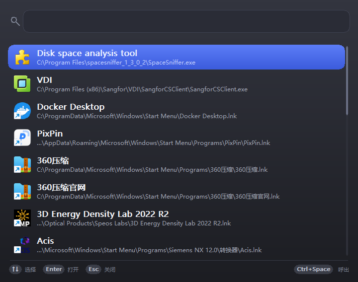
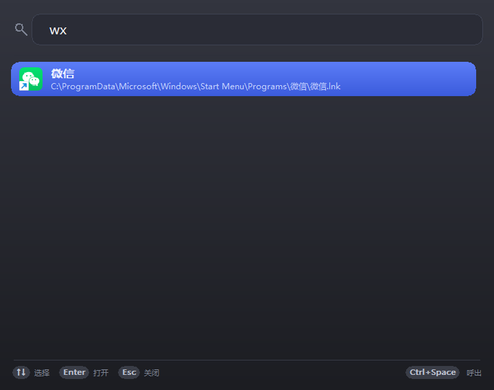
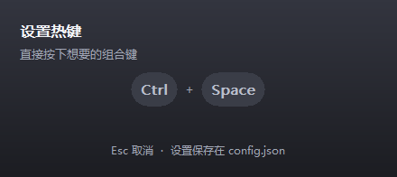

<div align="center">


# MiniLaunch 极简启动器

### Minimal Windows Launcher · 呼出 → 搜索 → 启动 / Invoke → Search → Launch

**一个把「程序启动」压缩到两次按键的 Windows 桌面启动器。**
**A Windows launcher that compresses "launching an app" into two keystrokes.**

纯 Win32 原生自绘 UI · 零 NuGet 依赖 · 零反射 · **空闲 CPU 占用 0%**
Native Win32 self-drawn UI · Zero NuGet packages · Zero reflection · **0% CPU while idle**

[低内存](#-低内存--低资源占用--low-memory--low-resource-footprint) · [功能特性](#-功能特性--features) · [界面截图](#-界面截图--screenshots) · [快速开始](#-快速开始--getting-started) · [技术细节](#-技术细节--technical-notes) · [English](#english-readme)

---

## 🧠 低内存 · 低资源占用 / Low Memory · Low Resource Footprint

<div align="center">

### 空闲时 **0.000% CPU** · 私有内存 **15 MB** · 内存零增长
### **0.000% CPU** while idle · **15 MB** private memory · Zero growth over time

</div>

**常驻内存占用低、消耗资源少**是 MiniLaunch 的第一设计目标，而不是事后优化。
**Minimal resident memory and resource consumption** is the *first* design goal of MiniLaunch, not a later optimization.

下表为**实测数据**（Windows 10/11，Release 自包含裁剪单文件版，`--preview` 模式运行 12 秒后采样 10 秒）：
The table below shows **measured numbers** (Windows 10/11, Release self-contained trimmed single-file build, sampled for 10 s after a 12 s warm-up in `--preview` mode):

| 指标 | Metric | 实测 | Measured |
| --- | --- | --- | --- |
| **空闲 CPU 占用** | **Idle CPU usage** | **0.0 ms / 10 s（0.000% 单核）** | **0.0 ms per 10 s (0.000% of one core)** |
| **私有内存（常驻）** | **Private memory (resident)** | **15.2 MB** | **15.2 MB** |
| 工作集（含共享运行时页） | Working set (incl. shared runtime pages) | 50.6 MB，10 秒内**零增长** | 50.6 MB, **zero growth** over 10 s |
| 线程数 | Threads | 15 | 15 |
| 句柄数 | Handles | 423 | 423 |
| 可执行文件体积 | Executable size | **11.7 MB**（自包含 + 裁剪，单文件） | **11.7 MB** (self-contained + trimmed, single file) |
| 无 UI 纯逻辑进程 | Headless process (self-test) | **1.3 MB** 工作集 | **1.3 MB** working set |

#### 是怎么做到的 / How it stays small

| 手段 | Technique | 效果 |
| --- | --- | --- |
| **零定时器、零轮询** | No timers, no polling | 整个进程不注册任何 `SetTimer`、不用 `Thread.Sleep` 循环、不做后台刷新。**空闲时 CPU 时间增量为 0**，不是「很低」，是零 |
| **窗口隐藏用 `SW_HIDE`** | Hidden with `SW_HIDE`, never destroyed | 呼出/隐藏不销毁窗口、不重建字体与 GDI 对象，避免反复申请与释放系统资源 |
| **图标 LRU 硬上限 64** | Icon cache capped at 64 HICONs | 图标数量再多，常驻 GDI 对象也只有 64 个；驱逐时立即 `DestroyIcon`，不泄漏句柄 |
| **纯原生 Win32 UI** | Native Win32 UI only | 没有 WebView / Electron 的多进程渲染器（一个 Electron 应用光渲染进程就上百 MB），也没有 WinForms/WPF 的控件与样式对象开销 |
| **源生成 JSON + 裁剪** | Source-generated JSON, trimmed | 无反射、无元数据膨胀，运行时不需要加载整棵类型图 |
| **扫描分两阶段** | Two-phase scanning | UWP 扫描（要拉 powershell）推迟到窗口首次显示之后，**开机自启常驻时完全不消耗启动资源** |

> **对比参照**：一个基于 Electron 的启动器常驻内存普遍在 150–300 MB 量级；MiniLaunch 的私有内存约为其 **1/10 ~ 1/20**，且空闲 CPU 为 0。
> **For reference**: an Electron-based launcher typically sits at 150–300 MB resident. MiniLaunch uses roughly **1/10 – 1/20** of that, with zero idle CPU.

---

## 📖 项目简介 / About

<div align="center">

| 中文 | English |
| --- | --- |
| **MiniLaunch** 是一个对标 uTools 的 Windows 桌面启动器，但只保留最核心的一条链路：**呼出 → 搜索 → 启动**。 | **MiniLaunch** is a Windows desktop launcher in the spirit of uTools, stripped down to one single flow: **invoke → search → launch**. |
| **常驻内存占用低、消耗资源少**：实测**空闲 CPU 0.000%**（10 秒内 0.0 ms）、**私有内存 15.2 MB**、句柄 423、线程 15，且**内存零增长**。 | **Minimal resident memory and resource consumption**: measured **0.000% CPU while idle** (0.0 ms over 10 s), **15.2 MB private memory**, 423 handles, 15 threads, and **zero memory growth**. |
| 全部界面用 **Win32 P/Invoke 自绘**：没有 WinForms、没有 WPF、没有 WebView、没有 Electron，也**不引用任何 NuGet 包**。 | The entire UI is **hand-drawn with raw Win32 P/Invoke**: no WinForms, no WPF, no WebView, no Electron, and **no NuGet packages at all**. |
| JSON 序列化走 **`System.Text.Json` 源生成**，全程无反射，因此可以安全地裁剪（AOT）发布。 | JSON serialization uses **`System.Text.Json` source generation** — zero reflection, so the binary can be safely trimmed and published AOT. |
| 窗口隐藏使用 `SW_HIDE`（不销毁）、**零定时器、零轮询**，图标只保留 LRU 64 项 HICON，因此**长期挂机也不涨内存、不吃 CPU**。 | The window is hidden with `SW_HIDE` (never destroyed), there are **no timers and no polling**, and only 64 HICONs are kept in an LRU cache — so it can sit in the tray for days without growing or burning CPU. |
| 一次按键呼出（默认 `Ctrl+Space`），输入即筛，方向键选，`Enter` 启动。 | One keystroke to summon (default `Ctrl+Space`), type to filter, arrow keys to select, `Enter` to launch. |

</div>

---

## ✨ 功能特性 / Features

<div align="center">

| 功能 | Feature | 说明 |
| --- | --- | --- |
| **全局热键呼出** | Global hotkey | 默认 `Ctrl+Space`，可从托盘菜单现场录制修改，注册失败时气泡提示并保留旧配置 |
| **模糊搜索** | Fuzzy search | 空格分词 **AND** 匹配；打分顺序：名称前缀 > 名称包含 > 别名/路径，再叠加使用频率权重 |
| **拼音别名** | Pinyin aliases | 内置常见中文软件拼音缩写表，输入 `wx` 即可搜到「微信」，无需引入全量拼音库 |
| **四路来源聚合** | Multi-source aggregation | 自定义条目 > 开始菜单 > 注册表卸载项 > UWP 商店应用，按小写名称去重合并 |
| **图标缓存** | Icon cache | 图标在**后台线程**提取，UI 绘制只读缓存；LRU 保留 64 项 HICON，驱逐时销毁 |
| **拖放添加** | Drag & drop | 把 exe / 快捷方式拖进窗口，立即添加为自定义条目并持久化 |
| **使用频率排序** | Usage-based ranking | 最近 24 小时用过的条目额外加权，常用程序自然浮到前面 |
| **托盘菜单** | Tray menu | 设置热键 / 添加程序 / 重新扫描 / 开机自启 / 退出 |
| **开机自启** | Auto-start | 可选开机常驻；启动时分两阶段扫描，开机不占启动资源 |
| **数据本地化** | Fully local | 配置与统计只落在 `%APPDATA%\MiniLaunch\`，不上传任何数据 |

</div>

### 搜索是怎么打分的 / How ranking works

| 命中位置 | Match | 基础分 |
| --- | --- | --- |
| 名称前缀 | Name prefix | `100` |
| 名称包含 | Name contains | `80 - min(位置, 20)` |
| 别名 / 路径 / 其他字段 | Alias / path / others | `55` |
| 历史使用次数 | Usage count | `+ log2(1+次数) × 12`（上限 30） |
| 24 小时内用过 | Used within 24h | `+15`（7 天内 `+8`） |

> 多个关键词之间为 **AND** 关系，得分相加后降序排列；得分相同时按名称字典序，保证结果稳定可预期。
> Multiple keywords are combined with **AND**; scores are summed and sorted descending, with a stable name-ordinal tie-break.

---

## 📸 界面截图 / Screenshots

> 以下均为**真实运行截图**（Windows 10/11，100% 缩放）。 / All screenshots below are taken from the real running app.

### 1. 主界面 · Main window

呼出后的完整列表：搜索框 + 图标/标题/路径三段式结果行 + 底部快捷键栏。
The full list after invoking: search box, three-part result rows (icon / title / path) and a shortcut hint bar at the bottom.

<p align="center">
  
</p>

### 2. 搜索 · Search

输入「微信」即时筛选，命中项高亮显示。
Type "微信" to filter instantly; the matched row is highlighted.

<p align="center">
  
</p>

### 3. 拼音别名搜索 · Pinyin alias search

只输入 `wx`，通过内置别名表命中「微信」。
Typing just `wx` hits 「微信」 through the built-in alias table.

<p align="center">
  
</p>

### 4. 热键设置 · Hotkey recorder

从托盘菜单打开，按下即生效，`Esc` 取消，无需重启。
Opened from the tray menu; the new combo applies immediately, `Esc` cancels.

<p align="center">
  
</p>

---

## 🚀 快速开始 / Getting Started

### 系统要求 / Requirements

| | |
| --- | --- |
| 操作系统 / OS | Windows 10 1607+ / Windows 11（**不支持** Win7 / 8.1，.NET 8 运行时本身不支持） |
| 运行时 / Runtime | **无需安装 .NET** — 发布的单文件 exe 已自包含整个运行时 |
| 磁盘 / Disk | 单文件约 **12 MB**（自包含 + 裁剪） |

### 构建 / Build

```bash
cd MiniLaunch
dotnet build
```

日常调试用 Debug（JIT）即可。

### 自检 / Self-test

```bash
MiniLaunch/bin/Debug/net8.0-windows/MiniLaunch.exe --selftest
```

必须**全绿**（当前基线 **45 项通过**），退出码为 `0`。每次改动后请务必执行。
Must be **all green** (current baseline: **45 assertions passed**) with exit code `0`. Run it after every change.

```
===== 自检结果: 通过 45 / 失败 0，耗时 1441ms =====
当前进程工作集: 1.3 MB
```

### 发布单文件 / Publish a single file

> ⚠️ `-o` 必须给**纯 ASCII 绝对路径**（仓库目录名含中文，经 shell 包装器执行时路径会错位）。
> ⚠️ The `-o` path must be **pure ASCII** — this repo's folder name contains Chinese characters.

```bash
dotnet publish -c Release -r win-x64 --self-contained \
  -p:PublishSingleFile=true -p:PublishTrimmed=true \
  -o "E:\code\_tmp_publish"

cp /e/code/_tmp_publish/MiniLaunch.exe /e/code/_tmp_publish/MiniLaunch.pdb \
   "/e/code/启动器/publish/win-x64/"
```

发布后核对：运行 `./MiniLaunch.exe --selftest`，应显示 **45 项通过**（拿到旧产物只会显示 38）。

> 发布**不带** `PublishReadyToRun` —— SDK 的单文件打包器会重建宿主 exe 并丢弃图标资源（PE 里只剩 RCDATA/VERSION/MANIFEST）。
> Do **not** enable `PublishReadyToRun` — the single-file bundler rebuilds the host executable and drops the embedded icon resource.

---

## 🔧 技术细节 / Technical Notes

| 约束 | Constraint | 说明 |
| --- | --- | --- |
| 常驻内存 | Tiny footprint | **空闲 CPU 0.000%（实测 10 秒 0.0 ms）· 私有内存 15.2 MB · 句柄 423 · 线程 15 · 内存零增长**；窗口隐藏用 `SW_HIDE` 不销毁，零定时器、零轮询，图标 LRU 上限 64 项 |
| 纯 Win32 | No UI framework | 所有控件都是原生窗口（`EDIT` 子控件经 `SetWindowSubclass` 子类化），列表用 GDI 双缓冲自绘；无 WebView/Electron 渲染进程 |
| 零 NuGet | No NuGet packages | 只依赖 .NET 8 BCL；JSON 用源生成上下文 `JsonCtx` |
| 零反射 | No reflection | 所有可序列化类型都在 `JsonCtx` 中登记 `[JsonSerializable]`，保证裁剪/AOT 安全 |
| W 版 API | Unicode-only P/Invoke | 所有带 `string`/`StringBuilder` 的 `DllImport` 均声明 `CharSet = CharSet.Unicode`，保证中文路径可用 |
| UTF-8 BOM | BOM-encoded sources | 源文件一律 UTF-8 with BOM（系统代码页为 GBK 时会乱码），csproj 另设 `CodePage=65001` |
| 低版本降级 | Graceful degradation | `SetProcessDpiAwarenessContext`、`GetDpiForWindow` 等高版本 API 统一降级到 `SetProcessDPIAware` / `GetDeviceCaps`，老系统不会崩 |
| 常驻内存 | Tiny footprint | 窗口隐藏用 `SW_HIDE` 不销毁；零定时器、零轮询；图标 LRU 64 项；后台线程用完即退 |
| 两阶段扫描 | Two-phase scanning | 开始菜单/注册表（约 30 ms）先发布；UWP 需拉 powershell（约 1.3 s），等窗口首次显示后再执行 |
| 图标后台化 | Background icon extraction | 提取走后台线程，UI 只读缓存；**HICON 的创建/销毁只在 UI 线程**，避免绘制过程中被驱逐 |
| UWP 缓存哨兵 | Cache sentinel | `uwp-cache.json` 写入一条空名哨兵记录扫描时间戳，否则 0 条时每次启动都会重跑 powershell |

### 目录结构 / Project layout

```
MiniLaunch/src/
  Program.cs       入口：单实例 Mutex、命名 Event、热键、托盘、消息循环、两阶段扫描
  Win32.cs         全部 P/Invoke / 结构体 / 常量（新增 API 只加在这里）
  Config.cs        AppConfig / CustomEntry / UsageDb / JsonCtx 源生成 / 原子写配置
  Entry.cs         条目模型与合并去重（Custom > StartMenu > Registry > Uwp）
  Scanners.cs      开始菜单 / 注册表 / UWP 三路扫描器
  Pinyin.cs        常见中文软件拼音别名表
  Search.cs        分词 AND 匹配与打分排序
  IconCache.cs     HICON 提取与 LRU 缓存
  AppIcon.cs       应用图标加载（RT_GROUP_ICON）
  Dpi.cs           DPI 感知设置与降级
  Launcher.cs      ShellExecuteEx 封装
  Theme.cs         配色表与 GDI 绘制工具
  MainWindow.cs    主窗口（无边框自绘 + 原生 EDIT 子类化 + 拖放 + 右键菜单）
  HotkeyDialog.cs  热键录制小窗
  Tray.cs          托盘菜单
  NativeOut.cs     管道 stdout 输出（WinExe 无控制台）
  SelfTest.cs      --selftest 全部断言
```

### 运行时数据 / Runtime data

`%APPDATA%\MiniLaunch\` 下的三个文件，写入一律走「写临时文件再原子替换」：

| 文件 | 用途 |
| --- | --- |
| `config.json` | 热键、开机自启、自定义条目 |
| `usage.json` | 各条目的使用次数与最后使用时间 |
| `uwp-cache.json` | UWP 条目缓存 + 扫描时间戳哨兵（7 天有效期） |

---

## ❓ 常见问题 / FAQ

**Q：热键 `Ctrl+Space` 按不动？**
A：它常被中文输入法占用。注册失败时程序会弹气泡提示但**不会崩溃、也不会偷偷改你的配置**；打开托盘菜单「设置热键…」现场录制一个别的组合即可，改完立即生效、无需重启。

**Q：怎么把不在列表里的程序加进来？**
A：直接把 exe 或快捷方式**拖进窗口**，或者用托盘菜单「添加程序…」。自定义条目的优先级最高。

**Q：UWP 应用为什么有时候搜不到？**
A：UWP 列表来自 `Get-StartApps`（powershell），有 7 天磁盘缓存。开机自启常驻时该扫描会推迟到窗口首次显示之后执行，属于正常行为。

**Q：为什么发布产物比预期大 / 图标丢了？**
A：确认没有开启 `PublishReadyToRun`，并确认用的是**最新**产物（`--selftest` 显示 45 项而不是 38 项）。

---

## 📚 设计文档 / Design docs

| 文档 | 内容 |
| --- | --- |
| [`方案.md`](方案.md) | 总体方案，第八节列出了**明确不做**的功能清单（插件 / 剪贴板 / 截图 / 同步等） |
| [`详细计划.md`](详细计划.md) | 分阶段实施计划 |
| [`审查记录.md`](审查记录.md) | 已知问题与处置结论 |
| [`AGENTS.md`](AGENTS.md) | 面向 AI/协作者的工程约定与「易踩的坑」清单 |

---

## 📄 许可 / License

本仓库暂未附带 LICENSE 文件。发布到公开仓库前请先补充一份许可协议（例如 MIT）。

No LICENSE file is bundled yet. Add one (e.g. MIT) before publishing to a public repository.

---

# English README

<div align="center">


**MiniLaunch** — a minimal Windows launcher.
Pure Win32 self-drawn UI · Zero NuGet packages · Zero reflection · Tiny resident footprint

</div>

## What it is

MiniLaunch does exactly one thing, extremely well: **invoke → search → launch**.
Press `Ctrl+Space`, type a few characters, hit `Enter`. Everything else is deliberately left out.

- **Tiny memory footprint and near-zero resource usage.** This is the *first* design goal, not a later optimization: **0.000% CPU while idle** (measured: 0.0 ms of CPU time over a 10-second idle window), **15.2 MB private memory**, 423 handles, 15 threads, and **zero memory growth** over time. The window is hidden with `SW_HIDE` instead of being destroyed, there are **no timers and no polling loops**, and the icon cache is hard-capped at 64 HICONs. No WebView or Electron renderer processes.
- **Pure Win32, self-drawn UI.** No WinForms, no WPF, no WebView, no Electron. The search box is a native `EDIT` control subclassed with `SetWindowSubclass`; the result list is painted by hand with double-buffered GDI.
- **Zero NuGet packages, zero reflection.** JSON is handled by `System.Text.Json` source generation (`JsonCtx`), so the app trims cleanly and is NativeAOT-friendly.
- **Tiny resident footprint.** The window is hidden with `SW_HIDE` instead of being destroyed, there are no timers and no polling loops, and only 64 HICONs are kept in an LRU cache.
- **Self-contained single file.** The published executable is roughly 12 MB and needs **no .NET installation** on the target machine.

## Screenshots

| | |
| --- | --- |
| **Main window** — the full list after invoking<br> | **Search** — filter as you type<br> |
| **Pinyin alias** — `wx` finds 「微信」<br> | **Hotkey recorder** — applies instantly<br> |

## Features

| Feature | Details |
| --- | --- |
| Global hotkey | Defaults to `Ctrl+Space`; re-recordable from the tray menu, applies immediately without a restart |
| Fuzzy search | Space-separated tokens combined with **AND**; name prefix (100) > name contains (80−offset) > alias/path (55), plus a usage-frequency boost |
| Pinyin aliases | A curated table of Chinese app abbreviations — `wx` matches 「微信」 without shipping a full pinyin dictionary |
| Four-source aggregation | Custom entries > Start Menu > Registry uninstall keys > UWP apps, de-duplicated by lowercase name |
| Icon cache | Icons are extracted on a **background thread**; the UI only reads the cache. LRU of 64 HICONs, destroyed on eviction |
| Drag & drop | Drop an `.exe` or a shortcut onto the window to add a custom entry |
| Usage ranking | Apps used in the last 24 hours get an extra boost and float to the top |
| Tray menu | Set hotkey / Add app / Rescan / Start with Windows / Quit |
| Fully local | Config and usage stats live in `%APPDATA%\MiniLaunch\`; nothing ever leaves your machine |

## Measured footprint

| Metric | Measured |
| --- | --- |
| **Idle CPU usage** | **0.0 ms per 10 s (0.000% of one core)** |
| **Private memory (resident)** | **15.2 MB** |
| Working set (incl. shared runtime pages) | 50.6 MB — **zero growth** over 10 s |
| Threads / Handles | 15 / 423 |
| Executable size | **11.7 MB** (self-contained + trimmed, single file) |
| Headless process (self-test) | **1.3 MB** working set |

> Measured on Windows 10/11 with the Release self-contained trimmed build.
> For reference, an Electron-based launcher typically sits at 150–300 MB resident — roughly **1/10 – 1/20** of MiniLaunch's private memory, with zero idle CPU.

## Build, test, publish

```bash
# build (Debug / JIT is enough for day-to-day work)
cd MiniLaunch && dotnet build

# headless self-test — must be all green (baseline: 45 assertions), exit code 0
MiniLaunch/bin/Debug/net8.0-windows/MiniLaunch.exe --selftest

# publish a self-contained, trimmed single file
dotnet publish -c Release -r win-x64 --self-contained \
  -p:PublishSingleFile=true -p:PublishTrimmed=true \
  -o "E:\code\_tmp_publish"
```

> The `-o` path must be **pure ASCII** — this repository's directory name contains Chinese characters.
> Do **not** enable `PublishReadyToRun`: the single-file bundler rebuilds the host executable and drops the embedded icon resource.

## Requirements

Windows 10 1607+ / Windows 11. Windows 7 and 8.1 are not supported (the .NET 8 runtime itself does not support them). No .NET runtime needs to be installed on the target machine.

## Design notes

- All UI metrics are defined at 96 DPI and scaled at runtime; DPI changes rebuild the fonts and re-layout the edit control.
- High-version APIs (`SetProcessDpiAwarenessContext`, `GetDpiForWindow`) are probed and gracefully downgraded so older systems never crash.
- Scanning runs in two phases: Start Menu + Registry (~30 ms) publish immediately, while UWP (which needs PowerShell, ~1.3 s) waits until the window has been shown for the first time.
- Icon `HICON`s are created and destroyed **only on the UI thread**, so a cache eviction can never pull an icon out from under a paint operation.

See [`方案.md`](方案.md), [`详细计划.md`](详细计划.md), [`审查记录.md`](审查记录.md) and [`AGENTS.md`](AGENTS.md) for the full design rationale.
